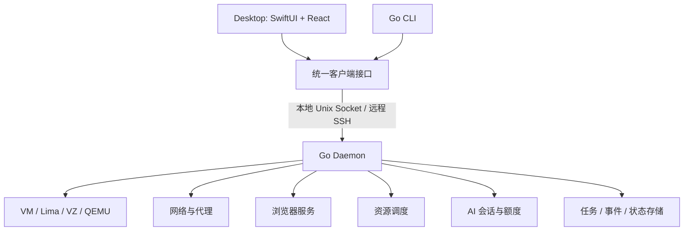

# Agent-VM 服务化架构改造计划

- 基线：`feat/zhu`，规划时参考提交 `9d27e4e`
- 状态：批次 1（Phase 0–3）已完成并通过单元测试与竞态检测；待推进批次 2（Phase 4–5）
- 目标：一个后台管理服务、两个客户端入口，支持 Mac Pro 长期运行与 Mac Air 远程开发。

## 1. 原则与目标架构

保留单仓库和模块化单体架构，复用 Go、Lima、VZ/QEMU、SwiftUI + React、EasyTier + SSH。不重写现有功能，不引入 Redis、MySQL 或 Docker 等额外基础设施。保持原有 CLI、虚拟机数据、共享目录、网络隔离、Fail-Closed 和文件保护兼容。



Daemon 负责管理生命周期；底层虚拟机、浏览器仍由其各自运行机制管理。Desktop 负责交互，CLI 负责命令与终端。三者不是三个独立常驻服务。

## 2. 建议目录

```text
cmd/agent-vm/
internal/
  daemon/       # 服务生命周期
  api/          # 版本化 API
  client/       # Go 客户端 SDK
  cli/          # 兼容现有 CLI
  vm/
  network/
  browser/
  resource/
  session/
  remote/
  storage/
  events/
  scheduler/
native-macos/   # SwiftUI + React + Native API Bridge
deploy/launchd/
deploy/systemd/
third_party/
patches/
docs/
```

目录为目标结构，不要求一次性移动现有代码。优先使用同一个 agent-vm 二进制，通过 daemon 子命令区分服务与客户端。

## 3. 分阶段实施

### Phase 0 — 代码审计与迁移准备（P0）

- [x] 获取最新分支，梳理 Go、SwiftUI、React 的依赖与职责。
- [x] 确认 VM、代理、浏览器、远程连接、资源管理进程归属。
- [x] 盘点配置、凭据、历史数据、文件权限与现有第三方补丁。
- [x] 明确兼容接口、状态迁移、回滚路径，避免重复开发。

### Phase 1 — Daemon 基础（P0）

- [x] 新增 daemon 前台运行入口及 start、stop、restart、status、install、uninstall、logs 管理命令。
- [x] HTTP + JSON over Unix Domain Socket：`~/.agent-vm/run/agent-vm.sock`。
- [x] Socket 和父目录仅允许当前用户访问；不默认监听公网端口。
- [x] 单实例锁、优雅退出、健康检查、结构化日志和轮转。
- [x] macOS 用户级 launchd LaunchAgent：登录后启动、异常重启；明确主动停止语义，防止被立即重启。
- [x] 实现 Go 客户端 SDK；为后续 systemd 适配保留接口。

### Phase 2 — 核心管理逻辑迁移（P0）

- [x] VM Manager：创建、启动、停止、暂停、恢复、删除与状态监控（pause/resume 已保留统一 API 契约并返回显式 501，待底层支持）。
- [x] Network Manager：代理配置、出口管理、EgressGate。
- [x] Browser Manager：Chromium 生命周期、健康、进程树内存监控。
- [x] Volume Manager：默认公共共享、项目和额外挂载、权限与保护。
- [x] Resource Manager：CPU、内存、磁盘、空闲识别。
- [x] Session / Tool / Quota Manager：会话、工具安装升级、版本检测、额度缓存。
- [x] Remote Manager：统一主机配置与远程接入（`~/.agent-vm/config/hosts.json` 与 `/api/v1/hosts`）；客户端持有的 SSH 凭据不迁移到远端。
- [x] 每 VM 操作互斥、全局配置写入协调、任务状态恢复；迁移后禁止旧路径绕过协调并发修改（旧 CLI `scratch` 与 `destroy-all` 等写路径已统一接入 per-VM 文件锁）。
- [x] 复用现有实现，逐模块切换，保留可回滚路径。

### Phase 3 — 统一 API（P0）

健康检查 GET /health；其余接口使用 /api/v1 前缀。

| Method | Path | 功能 |
|---|---|---|
| GET | /vms | VM 列表 |
| POST | /vms | 创建 |
| GET | /vms/:id | 详情 |
| DELETE | /vms/:id | 删除 |
| POST | /vms/:id/start | 启动 |
| POST | /vms/:id/stop | 停止 |
| POST | /vms/:id/pause | 暂停 |
| POST | /vms/:id/resume | 恢复 |
| GET | /vms/:id/resources | 资源 |
| GET | /vms/:id/mounts | 挂载 |
| GET | /vms/:id/browser | 浏览器 |
| GET | /vms/:id/sessions | 会话 |
| GET | /network/status | 网络安全状态 |
| GET | /tasks/:id | 后台任务 |
| GET | /events | SSE 事件流 |

- [x] 耗时操作返回 Task ID，SSE 推送进度与最终结果。
- [x] 客户端断开不取消任务；明确任务超时、取消（`POST /api/v1/tasks/:id/cancel`）、幂等（`Idempotency-Key`）及重启后的状态协调，不盲目重放破坏性操作。
- [x] 统一错误格式（`{"code": "...", "error": "..."}`）、输入验证、接口版本（`X-Agent-VM-API-Version: 1`）与客户端兼容策略。
- [x] 补全代理、共享目录、浏览器、会话、额度、远程主机等写入接口。

### Phase 4 — Desktop 解耦（P0）

- [ ] 保留当前 SwiftUI 原生外壳、菜单栏、React 界面及样式。
- [ ] SwiftUI 保留窗口、文件选择、通知、Keychain、Terminal 调用及受限 WKWebView Bridge。
- [ ] 将业务调用迁移为 React → SwiftUI Bridge → Daemon。
- [ ] 增加服务连接状态、任务进度、SSE 重连与状态刷新。
- [ ] 保留 VM 卡片、AI 额度、代理、浏览器、共享目录、设置等功能。
- [ ] 退出 App 不停止 Daemon 或已提交的后台任务。

### Phase 5 — CLI 与远程连接（P0）

保留现有命令，拟新增：

```bash
agent-vm host add mac-pro
agent-vm host list
agent-vm host remove mac-pro
agent-vm host check mac-pro
agent-vm --host mac-pro list
agent-vm --host mac-pro start dev
agent-vm --host mac-pro stop dev
agent-vm --host mac-pro shell dev
agent-vm --host mac-pro codex dev
agent-vm --host mac-pro claude dev
```

- [ ] 本地与远程共用 API 语义；支持全部 VM 状态，包括已停止 VM。
- [ ] 复用 EasyTier + SSH 密钥认证、严格主机密钥校验；远程管理通过受认证 SSH 通道访问 Daemon。
- [ ] SSH PTY 直接进入远端 VM，无须网页工作台。
- [ ] Desktop 按宿主机分组显示本地及远程 VM；连接异常不影响服务端任务。
- [ ] 保持 SSH agent/X11 转发禁用等原有安全边界。

### Phase 6 — AI 会话持久化（P0）

- [ ] VM 内引入 tmux，按 VM、项目、工具区分独立会话。
- [ ] 识别活跃会话，支持 list、attach、detach、stop。
- [ ] 客户端断网或关闭终端后任务继续运行；跨设备连接原会话。
- [ ] VM 或宿主机重启后，通过 AI 工具原生历史会话恢复，而不是声称能恢复已消失的进程。
- [ ] 防止自动休眠误伤后台 Agent；避免凭据或敏感会话内容进入日志。

### Phase 7 — 智能资源调度（P1）

- [ ] 复用现有 10 分钟空闲休眠、VZ 内存气球及浏览器进程树监控。
- [ ] 空闲时间、内存预警阈值（建议初始 85%，实际结合 macOS 内存压力）、回收策略可配置。
- [ ] 结合 CPU、I/O、进程和会话状态判断空闲，不仅依据终端窗口。
- [ ] 优先回收可回收内存，再评估允许暂停的空闲 VM。
- [ ] 默认保护活跃 Agent 与常驻浏览器；资源不足时限制新启动，不强制终止现有任务。

### Phase 8 — 长期运行与故障恢复（P0）

- [ ] launchd 管理服务重启，Daemon 启动时重新扫描并协调实际 VM 状态。
- [ ] 虚拟机启动策略：手动、登录后自动启动、恢复上次运行、可选定时启动。
- [ ] VM/浏览器异常退出按策略有限次数重试、退避并记录错误。
- [ ] SSH 断线后客户端重连；状态文件损坏时使用备份或重新扫描。
- [ ] 明确宿主机睡眠、合盖、电源与 FileVault 的限制；用户级 LaunchAgent 只保证登录后启动，不保证重启未解锁时可用。

### Phase 9 — 网络安全整合（P0）

- [ ] 保留 Lima/gVisor 底层补丁、指定代理、EgressGate 和 Fail-Closed。
- [ ] 强制代理策略在 Daemon 崩溃、重启及客户端退出时仍生效；底层不能因控制服务失联而允许直连。
- [ ] 验证代理异常、切换节点、旧连接撤销、DNS/IPv6/UDP 防泄漏。
- [ ] VM 恢复和浏览器重启时重新执行必要出口校验。
- [ ] 远程接口不扩大 VM 的宿主机或局域网访问权限。

### Phase 10 — Linux 服务端兼容（P2）

- [ ] 将 launchd 与 systemd、VZ 与 QEMU/KVM 的平台差异通过接口隔离。
- [ ] 复用 Go Daemon 与 CLI，Linux 不要求开发 SwiftUI 客户端。
- [ ] 根据宿主机资源决定浏览器及 VM 能力，不能假设所有 VPS 支持嵌套虚拟化。

## 4. 存储与兼容

优先复用 ~/.agent-vm 原有数据，新增目录建议：

```text
~/.agent-vm/
  config/daemon.json
  config/hosts.json
  config/resource-policy.json
  state/vms.json
  state/sessions.json
  state/tasks.json
  run/agent-vm.sock
  run/agent-vm.lock
  logs/
  backups/
  volumes/
  network/
  lima/
```

现有数据路径保持兼容；新增状态文件版本化、原子写入、必要备份；Lima 实际状态为 VM 运行状态的权威来源。代理密码、SSH 私钥、AI 凭据不集中保存为明文 JSON。未来需要时再评估 SQLite。

## 5. 批次与交付

| 批次 | 阶段 | 交付 |
|---|---|---|
| 1 | 0–3 | Daemon、核心模块及 API 基础 |
| 2 | 4–5 | Desktop 解耦、CLI 及远程统一 |
| 3 | 6、8、9 | 会话持久化、故障恢复、安全整合 |
| 4 | 7 | 资源调度 |
| 5 | 10 | Linux 适配 |

每批独立提交，保持已有功能可用。网络安全约束从第一批起贯穿迁移，而不是等到第三批才实现。逐步切换并保留回滚能力。

## 6. 验收清单

- [ ] 关闭 Desktop 后 VM 和后台任务继续运行。
- [ ] Daemon 异常退出后自动恢复并协调状态。
- [ ] CLI 与 Desktop 使用统一 VM 管理接口。
- [ ] Mac Air 能查看、启动、停止 Mac Pro 的 VM，并直接进入 CLI。
- [ ] 断开远程终端后 AI 任务继续运行，重连可恢复 tmux 会话。
- [ ] 关闭浏览器查看窗口后 Chromium 保持运行。
- [ ] 代理异常、切换及服务重启时不存在非授权直连或 DNS 泄漏。
- [ ] 客户端断开不影响后台任务。
- [ ] 已有 VM 和共享目录无需重新创建。
- [ ] 资源调度不误暂停活跃 Agent 或常驻浏览器。
- [ ] 宿主机重启并登录后按策略恢复服务环境。
- [ ] AI 额度展示与会话功能不退化。
- [ ] Mac Air 无须启动本地 VM 即可远程开发。
- [ ] 已有 CLI 行为、配置及文件保护兼容。

## 7. 设备分工

- **MacBook Pro**：Go Daemon、VM、AI 任务、浏览器、共享文件、网络及资源管理。
- **MacBook Air**：Desktop、CLI、SSH、会话连接和按需本地开发。
- **1C1G VPS**：轻量网络中转、EasyTier 或代理，不承担完整 VM 和浏览器计算。

## 8. 范围说明

本文件是开发规划，不代表相关功能已完成或通过测试。Unix Socket、HTTP JSON、SSE、tmux、用户级 launchd 为当前建议方案；具体迁移范围及已有功能的完整性以 Phase 0 审计为准。保留个人浏览器定位，不新增 Agent 网页自动化需求。
